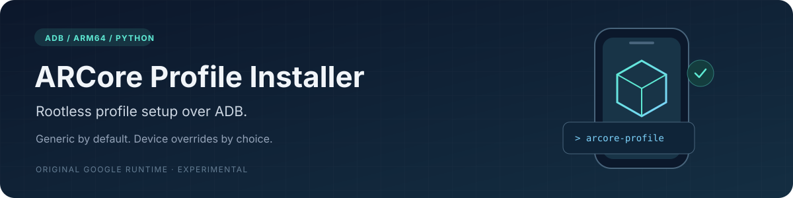

<p align="center">
  
</p>

<p align="center">
  <a href="https://github.com/balu100/arcore-profile-installer/actions/workflows/test.yml"></a>
  <a href="https://www.python.org/downloads/"></a>
  <a href="LICENSE"></a>
  <a href="VALIDATION.md"></a>
</p>

<p align="center">
  <a href="#run-from-a-clone">Quick start</a> ·
  <a href="#first-installation-or-explicit-profile-replacement">Initial setup</a> ·
  <a href="docs/FAQ.md">FAQ</a> ·
  <a href="CONTRIBUTING.md">Contributing</a>
</p>

# ARCore Profile Installer

An ADB tool for installing **Google's generic ARCore compatibility profile**,
optionally applying device-specific overrides, and updating the original Google
runtime without rewriting its APK.

**Generic mode is the default.** It copies the APK's own
`device_profile_max_compatibility.textproto` asset byte-for-byte. No dash values
are applied unless `--mode device` is selected. The generic profile is a
compatibility template, not accurate calibration for every camera or IMU.

Device mode is optional. Calibration is not universal: a profile for one model
must not be assumed correct for another. The first optional profile is for
**POCO X8 Pro Max / `dash`**. Its custom-profile
loading and Maps VIO initialization were observed on Android 16 / HyperOS
OS3.0.303.0.WPLEUXM with ARCore 1.56 and 1.57. This is not factory certification
or a claim of optimal tracking accuracy.

## Requirements

- Python 3.11+; no runtime pip dependencies.
- Android Platform Tools (`adb`) on PATH, USB debugging authorized.
- An ARM64 Android device. Generic mode does not require a registry entry;
  device mode requires matching device/manufacturer metadata. This release's
  staging backend is ARM64; x86 and 32-bit-only device setup is not implemented.
- For initial profile installation: the original ARM64 ARCore
  **1.6.181112096** APK, supplied separately.

Android Studio, root, Shizuku, Docker, firmware extraction and APK re-signing
are not required by this installer. The legacy Android full-backup/restore
backend and its on-device confirmation UI must still work. This has only been
tested on the device/build above, not on every Android version or ROM.

## Run from a clone

```sh
git clone https://github.com/balu100/arcore-profile-installer.git
cd arcore-profile-installer
python -m arcore_profile_installer profiles
python -m arcore_profile_installer status
```

Alternatively install the CLI with `python -m pip install .`, then use
`arcore-profile` in place of `python -m arcore_profile_installer`.

### Update an already-working setup

```sh
python -m arcore_profile_installer update
```

This fetches the latest ARM runtime published in the official
[Google SDK GitHub releases](https://github.com/google-ar/arcore-android-sdk/releases),
verifies the download size and GitHub SHA-256 digest, saves the installed APK,
and runs `adb install -r`. It does not clear app data. GitHub SDK runtime releases
may differ from Play Store staged rollouts.

**Updating preserves whichever custom profile is already on the phone.** The
default generic mode does not replace an existing dash profile during an update.
Changing profile mode requires explicit `install-profile` and app-data replacement.

For a local original APK, add `--apk /path/to/arcore.apk`. Android checks update
signature compatibility; this program does not forge or bypass APK signatures.
Local APK metadata checking alone is not cryptographic signature verification.

### Prepare a profile without touching a phone

```sh
python -m arcore_profile_installer prepare --apk /path/to/arcore.apk
```

This is generic mode: the extracted Google asset is unchanged. The output
metadata records equal base/output SHA-256 hashes.

For optional dash overrides:

```sh
python -m arcore_profile_installer prepare --mode device --device dash --apk /path/to/arcore.apk
```

In device mode, only the selected registry JSON overrides are applied. If
expected fields disappear or become ambiguous, preparation stops instead of
guessing. Prepared files, the selected mode, and source hashes are saved locally.

### First installation or explicit profile replacement

**This command uninstalls ARCore and replaces its app data.** Saving the original
APK does not back up its private app data. Maps app data is not cleared.

```sh
python -m arcore_profile_installer install-profile --staging-apk ./ARCore-1.6.181112096.apk --replace-arcore-data
```

This works in PowerShell and POSIX shells. The target runtime is fetched from
Google's latest SDK release; add `--apk ./current-arcore.apk` to use a local copy.

The command above installs Google's unchanged generic compatibility profile.
For device-specific overrides, add `--mode device`. The connected model is
then matched to the registry; unknown devices require an external measured
JSON via `--mode device --profile FILE`. There is no automatic dash fallback.

Keep the phone unlocked and approve each prompt, with an empty backup password:

1. Back up my data: create a fresh staging archive on this device.
2. Restore my data: restore the archive containing the selected custom profile.
3. Back up my data: verify that the restored profile bytes match exactly.

Only then is the modern runtime installed with `install -r`. The script checks
the installed version through ADB and prints it. A failure triggers an attempt
to restore a modern **runtime APK**; this does not guarantee restoration of
previous private data or profile functionality.

The pinned staging APK SHA-256 is:

```text
dfcfd34078d84bc687571c42d28b6a683ecece40d790f83582502d98b98cce11
```

The project does not redistribute this APK. Use an original Google-signed copy
matching the exact digest; do not use a renamed/random old version.

### Verify actual runtime loading

```sh
python -m arcore_profile_installer verify --seconds 45
```

Open Maps Live View during capture. The local report distinguishes custom-profile
loading, inertial tracking and VIO tracking. Missing loading logs can mean the
profile was loaded before capture; it is not automatic proof of failure.
A successful session is not a measurement of calibration accuracy, VPS coverage
or navigation precision.

## Device selection and output

If several devices are connected, the tool prefers a single device with a
registered codename. It never resolves ambiguity by choosing the first device.
Use `--serial SERIAL` to select explicitly. Before installation, the actual
codename and manufacturer must match the selected override **in device mode**.
Generic mode does not use a model-specific override and can be attempted on an
unregistered ARM64 model. Both modes require the primary user and the staging
backend capabilities; successful tracking on arbitrary models is not guaranteed.

The default private working directory is `.arcore-state/`. Change it with
`--work-dir PATH`. Downloads, recovery APKs, Android backups, console transcripts
and filtered diagnostics stay there. Logs can contain device identifiers and
location-related data: inspect and redact before sharing them.

## Adding another device

See [CONTRIBUTING.md](CONTRIBUTING.md). Profiles contain measurements, provenance,
tested firmware/runtime versions and limitations. A separate external JSON can
be selected with `--mode device --profile FILE`; it must still match the actual
device. `--device` and `--profile` are rejected in generic mode to avoid silently
ignoring a requested override.

The JSON registry contains only overrides, not extracted Google calibration
assets, personal Android backups, firmware binaries or phone logs. The Python
tool is MIT-licensed; Google APKs and extracted assets retain their own terms.

## Development

```sh
python -m unittest discover -s tests -v
```

Tests run offline with synthetic backups and metadata. The generalized initial
installation flow should not be described as tested on a new model until a
device owner has verified it. The original dash-specific tool remains separate.

## Background

- [Original custom-profile mechanism](https://github.com/tomthecarrot/arcore-for-all/issues/139)
- [Google's device-specific profile model](https://developers.google.com/ar/develop/device-certification)
- [Android APK signing/update rules](https://developer.android.com/studio/publish/app-signing)

This project is independent of Google and Xiaomi. No universal ARCore
certification, calibration generation or firmware modification is performed.
